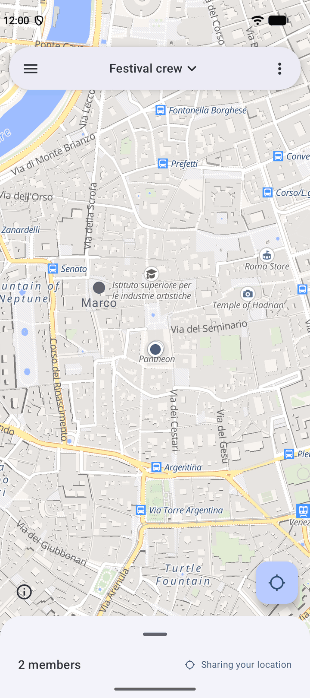
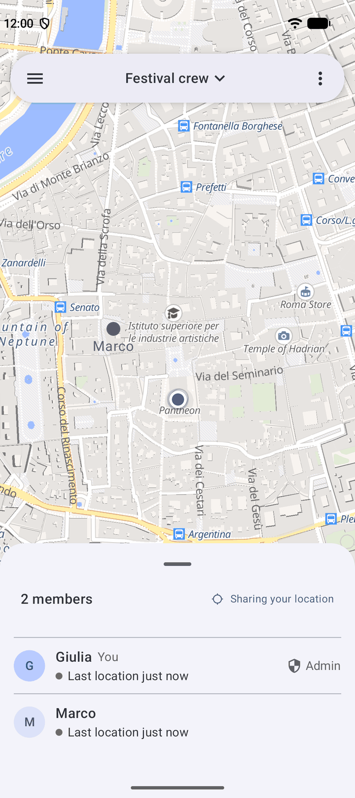
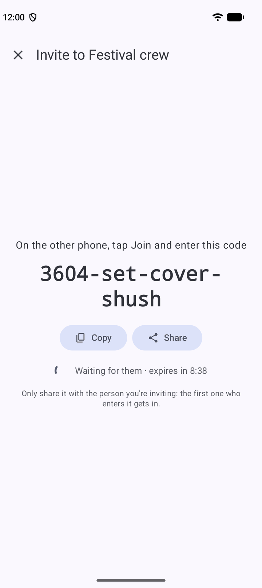
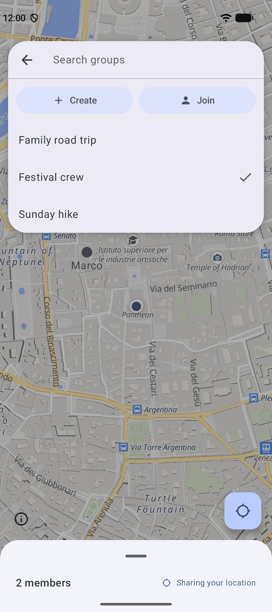

# Lockate

Share your location with the people you choose, and nobody else. Not even the server it travels through.

<p>
  
  
  
  
</p>

## What it's for

- Finding your friends in a crowd at a festival.
- Keeping a family car convoy together on a road trip.
- Knowing where everyone is on a group hike when the trail splits.
- Letting a friend see you got home safely.

## How it works

1. **Create a group.** Just pick a name.
2. **Invite people.** Tap **Invite** and read out the code that appears, like `7-guitar-ocean-lamp`. Any member can invite.
3. **They join.** Each person taps **Join**, enters the code and chooses the name the others will see.
4. **Everyone appears on a live map.** Tap a person to see their name and when they were last seen.

There is no sign-up. No email, no phone number, no account.

## Why it's private

Most location apps send your position to a company's server, which can read it. Lockate doesn't work that way.

Before anything leaves your phone, your location, your name and the group's name are locked with a random key that only the group's phones have. The server in the middle is like a mail carrier handling sealed envelopes: it delivers them to the right people but cannot open them.

Inviting someone hands them that key without the server ever seeing it. The two phones use the invite code to agree on a secret lock of their own, and the key travels inside it. If someone else tries the code, or it's typed wrong, the inviter's phone notices and nothing is sent. Each code works once and expires after 10 minutes.

Your phone also keeps sending updates when you're standing still. If it only sent them when you moved, the server could guess when you stopped, so Lockate doesn't give it that clue.

## What it doesn't do

- It runs on Android only for now.
- If every member leaves or uninstalls the app, the group can't be recovered. Nobody else has its key.
- Whoever enters an invite code first gets in. Read it out only to the person you're inviting.
- It needs a Lockate server to connect through. That is usually one run by someone you know, or by you. See [self-hosting](#self-hosting) if that's you.

## Getting started

1. Download the latest APK from the [Releases page](../../releases). Pick `arm64-v8a` for most phones, `armeabi-v7a` for older 32-bit phones, or `universal` if you're not sure (it's larger but works everywhere). `x86_64` is for emulators.
2. Open it on your phone. Android will ask you to allow installing apps from outside the Play Store. Allow it for this install.
3. Open Lockate and enter the server address. If whoever runs the server gave you an access key, enter that too.
4. Create a group, or join one with an invite code from one of its members.
5. When the app asks for location access, choose **Allow all the time**. Without it, sharing stops when your screen turns off.

## Questions

**Can the person running the server see where I am?**
No. They see encrypted data they can't read: not locations, not names, not the group's name.

**Do I need to keep the app open?**
No. Sharing continues in the background once you've allowed location access all the time.

**How do I stop sharing?**
Leave the group, or turn off location sharing in the app.

**What happens if I delete a group?**
It's gone for everyone, permanently.

**Is it free?**
Yes. Lockate is open source under the MIT license.

---

# For developers and self-hosters

## Under the hood

- Group names, member names and coordinates are encrypted client-side with AES-256-GCM, with a random group key that never leaves the members' devices.
- Invites use EC-JPAKE ([RFC 8236](https://www.rfc-editor.org/rfc/rfc8236)) keyed by the words of the invite code, from [Mbed TLS](https://github.com/Mbed-TLS/mbedtls) (Apache-2.0), called from Kotlin through `mobile_app/jpake`, a generic Kotlin Multiplatform J-PAKE module with RFC 8236 key confirmation. The server relays the messages through a short-lived Redis mailbox. Both phones confirm they derived the same key before the inviter sends the group key and a single-use join token, encrypted with a key derived from the shared secret.
- Members authenticate with a random 32-byte token that the server stores BCrypt-hashed.
- Locations are sent over WebSocket and received over SSE. The server relays them through Redis pub/sub without decrypting.

## Self-hosting

Run the stack with [`prod-docker-compose.yml`](prod-docker-compose.yml). Set these environment variables, for example in a `.env` file:

| Variable | Purpose |
| --- | --- |
| `POSTGRES_USER`, `POSTGRES_PASSWORD` | Database credentials |
| `REDIS_PASSWORD` | Valkey password |
| `ADMIN_API_KEY` | Logs in to the admin UI |
| `REQUIRE_API_KEY` | `true` to only accept clients that present a key |
| `ADMIN_UI_ORIGIN` | URL the admin UI is served from |
| `VITE_API_BASE_URL` | Backend URL the admin UI talks to |

The backend listens on port 3118 and the admin UI on 3119. Create and revoke API keys from the admin UI.

## Development

### Backend

**Prerequisites:** Java 21+, Docker

Start the dev infrastructure (PostgreSQL + Valkey):

```bash
cd backend
docker compose -f dev-docker-compose.yml up -d
```

Run the dev server:

```bash
./mvnw spring-boot:run -Pdev
```

Run all tests:

```bash
./mvnw clean test -Pdev
```

Run a single test class:

```bash
./mvnw test -Pdev -Dtest=InviteServiceTest
```

**Run a background job manually** - activate the job's profile, e.g. to run location retention cleanup:

```bash
./mvnw spring-boot:run -Pdev -Dspring-boot.run.profiles=job-location-retention
```

Build a production JAR:

```bash
./mvnw clean package -Pprod
```

### Mobile app

```bash
cd mobile_app
./gradlew assembleDebug
./gradlew test
```

## Tech stack

The backend is built with **Spring Boot**, uses **PostgreSQL** for storage, and **Redis** for real-time messaging. The Android app is built with **Jetpack Compose**.

---

## License

MIT
