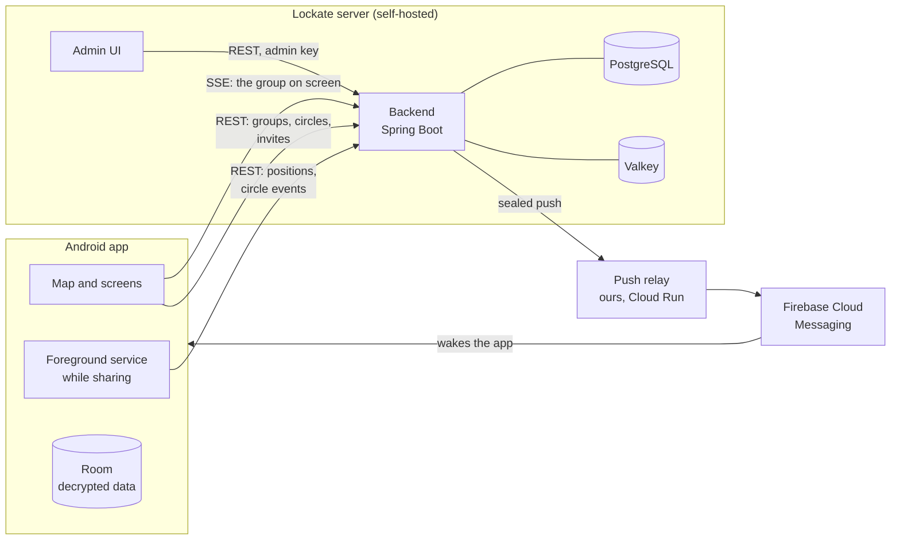
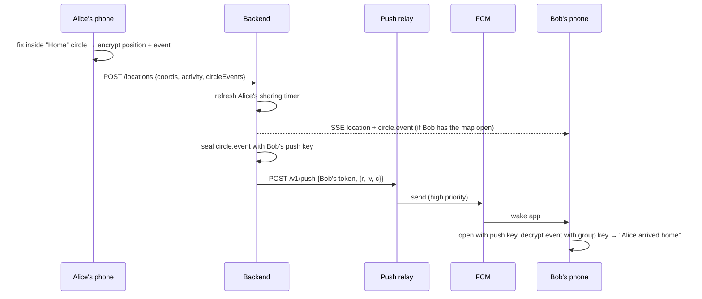
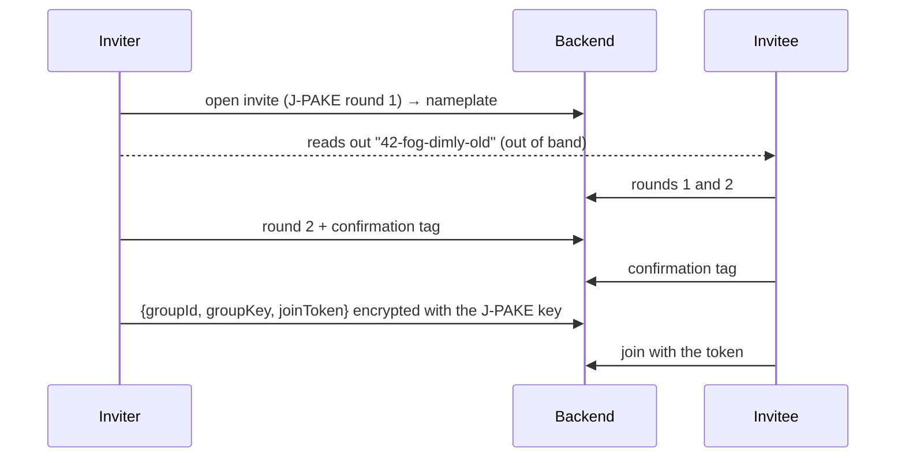

# Lockate architecture

Lockate shares the live location of a small group of people. It is zero-knowledge: everything
that says something about the people (names, coordinates, places, arrivals) is encrypted on the
phone with a key only the group's phones hold. The servers move and store ciphertext, and learn
only what they can't avoid learning: who is in which group, and when each member sends.

This document is the map. Each component has its own page with the details and the reasons behind
them; [roadmap.md](roadmap.md) says what is built and what comes next, and
[versioning.md](versioning.md) which versions of the components work together.

## Components

| Component | What it does | Runs |
|---|---|---|
| Android app (`mobile_app/`) | Encrypts and decrypts everything, follows our position, computes circle crossings, shows the map and notifications. | The user's phone |
| Backend (`backend/`) | Groups, members, circles, invites, relays ciphertext, decides who is sharing, sends pushes. | Anyone's server, with PostgreSQL and Valkey |
| Admin UI (`admin_ui/`) | Lists and deletes groups and members, manages API keys. Sees only ids, counts and times. | Next to the backend |
| Push relay (`push_relay/`) | Forwards a backend's sealed pushes to FCM with our Firebase credentials. | Us, once for every server |
| `jpake` / `jpake-native` | EC-JPAKE (RFC 8236) for invites, Mbed TLS behind a Kotlin Multiplatform API. | Inside the app |

A phone can be in groups on several servers at once; each server knows only its own groups.

## How data moves

| Situation | Transport |
|---|---|
| Moving | GPS every ~2 s, each position posted over REST on a reused connection. |
| Still | High-accuracy fix every 10 min, posted over REST. |
| Circle crossing | Inside the same request as the position that caused it. |
| Watching a group | SSE stream of the group on screen: positions and group changes. |
| Not on screen | Notifications by FCM push, encrypted end to end, through the push relay. |
| Not sharing anywhere | Nothing runs in the background. |

A member who sends a position is "sharing"; the map shows each member's last position green up to
15 min old, yellow up to 30, then grey, when the others are told the member stopped sharing.

Two flows show most of the system:

## Principles

- **The server is a mailbox.** It checks sizes, rates and permissions, and never decrypts. Every
  encrypted field has a fixed size, so its length says nothing. → [Encryption](architecture/encryption.md)
- **Ids are generated by the client.** They are part of the encryption's AAD; the server never
  overwrites an id that belongs to someone else. → [Groups and authentication](architecture/groups-and-auth.md)
- **Logic runs on the phone.** Circle crossings are computed by the member who crosses, and sent
  encrypted. → [Circles](architecture/circles.md)
- **Background work is driven by the OS, not by timers.** A location request wakes a still phone;
  FCM wakes a receiving one. Coroutine delays don't count the time the CPU sleeps. → [Sending
  positions](architecture/sending.md)
- **One way to do each thing.** Sending is always REST, receiving in the background is always push.

## Component pages

| Page | Covers |
|---|---|
| [Encryption](architecture/encryption.md) | Group key, AES-GCM fields, AADs, fixed sizes, what the server learns, local storage |
| [Groups and authentication](architecture/groups-and-auth.md) | Groups, members, admins, member tokens, client ids, API keys, retention |
| [Administration](architecture/admin.md) | The admin API, the admin UI, what the admin sees |
| [Invites](architecture/invites.md) | Invite codes, the J-PAKE exchange, the server mailbox |
| [Circles](architecture/circles.md) | Places of a group, geofencing on the phone, circle events |
| [Sending positions](architecture/sending.md) | Moving and still modes, the REST endpoint, Doze, rate limits, keeping the circles current |
| [Sharing](architecture/sharing.md) | Who is sharing, the Redis timer, map colours |
| [Real-time](architecture/realtime.md) | The SSE stream of the group on screen, why there is no socket, Redis pub/sub across instances |
| [Push notifications](architecture/push.md) | Registration, sealed payloads, what the app does with a push |
| [Push relay](architecture/push-relay.md) | Why it exists, what it sees, how it runs and is deployed |
| [Health check](architecture/health-check.md) | The hourly check of servers, membership and push registrations |
| [Environments](architecture/environments.md) | Prod and staging app flavors, Firebase and relay per environment |
