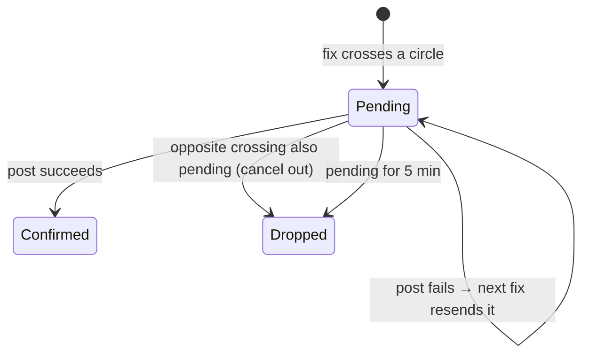

# Circles

[← Architecture](../architecture.md)

A circle is a place of a group (home, school…). Members are told when someone arrives or leaves.

## Storage

Any member creates, edits and deletes circles with `PUT|DELETE
/api/v1/anonymous-groups/{id}/circles/{circleId}`; the app generates the id. Centre, radius and
name are three encrypted fields of fixed size ([Encryption](encryption.md)), so every circle looks
the same to the server. Changes reach the group as `circle.upserted` / `circle.deleted`
([Real-time](realtime.md)).

## Geofencing on the sender's phone

Crossings are computed by the member who crosses, never by the server (it can't read positions)
or by the receivers (they'd need our positions continuously). `GeofenceTracker`, one per group,
tracks only ourselves:

- it feeds on our own fixes and ignores inaccurate ones;
- it starts silently from the first fix; a circle added, moved or resized takes the state of the
  last position the server got from us (if under 5 minutes old), so a crossing made since is
  announced but a circle created around us isn't, and editing a circle notifies nobody;
- its circles come from Room, refreshed when a location post finds they changed, and events are
  only ever sent computed on the circles the server has
  ([Sending positions](sending.md#keeping-the-circles-current));
- each transition is a circle event: circle id + enter/exit, one AES-GCM field of 33 bytes, no
  timestamp (receivers use the server's).

## Delivery: confirmed by the server

A circle event only ever comes from a position, so it travels in the same request as that position
([Sending positions](sending.md)). There is no queue: the tracker compares against the last state
**the server confirmed** (the circles it knows we are in), not the last state seen.

- A failed post changes nothing, so the next position recomputes and resends the same transitions.
- An entry and an exit both unconfirmed cancel out and are never sent.
- One unconfirmed for 5 minutes is dropped: receivers use the server's time, and a late "arrived
  home" would be wrong.
- The confirmed state is only in memory: after the process restarts the tracker reseeds silently,
  and a transition pending at that moment, or made while the process was dead, isn't notified.
  Persisting it in Room is an open point ([Roadmap](../roadmap.md)).

The server checks at most 16 events per request, each at its exact size, before relaying anything,
then publishes them in order as `circle.event` frames with its own timestamp. Circle events are
never stored.

## Notifications

Notifications come only from live `circle.event` and sharing frames, never from stored records:
by push ([Push notifications](push.md)); a server without a push relay notifies nothing.
`CircleNotifier` shows them: one notification per member, replaced by each new event, under one
summary per group (`CircleNotificationBook`); they expire after 1 hour. Muted circles and members
are kept only in Room.
