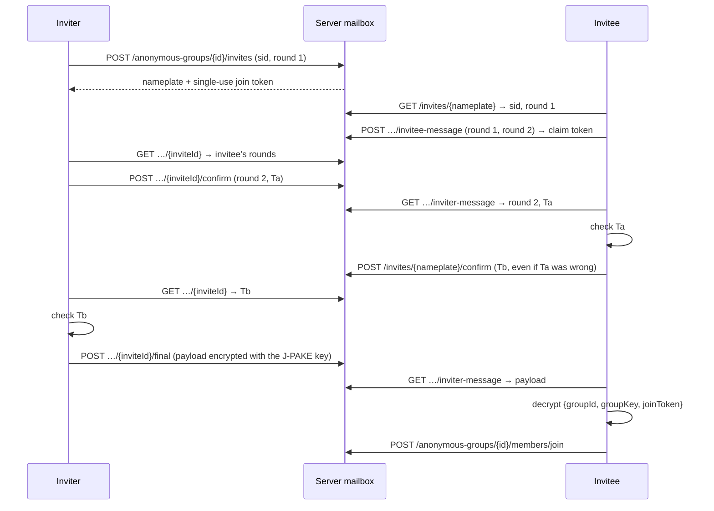

# Invites

[← Architecture](../architecture.md)

An invite moves the group key from a member's phone to a new one, through a server that must not
learn it, protected only by a short code read out loud.

## The code

`nameplate-w1-w2-w3`, for example `42-fog-dimly-old`. The nameplate (1–9999) picks the mailbox on
the server; the three words from the EFF short list are the password. Any member can invite.
`InviteCode` parses and builds it.

## The exchange

EC-JPAKE ([RFC 8236](https://www.rfc-editor.org/rfc/rfc8236), P-256, SHA-256): both phones prove
they know the same password and derive a shared key, and someone who doesn't know it gets one
guess. The inviter is the J-PAKE server, the invitee the client.

Each side polls the mailbox for the other's next message (`GET …/{inviteId}` for the inviter,
`GET /invites/{nameplate}/inviter-message` for the invitee). The inviter can cancel with
`DELETE …/{inviteId}`.

- The invitee's post is accepted once (a second gets 409) and returns a claim token required for
  the rest of its calls (`X-Invite-Claim`), so nobody else can take over the mailbox.
- Key confirmation as in RFC 8236 section 5: `HMAC(k', "KC_1_U" || myId || peerId || myKeyShares ||
  peerKeyShares)`, 32 bytes. The invitee posts Tb even when Ta was wrong, so the inviter learns at
  once.
- A failed check cancels the invite: each code gets one guess.
- The payload is AES-GCM with a key derived by HKDF from the J-PAKE key (info
  `lockate-invite-payload`); the password label is `lockate-invite-v2` and the session id is the
  HKDF context.
- Invites expire after 10 minutes. Whoever enters the code first gets in, so it must be read out
  only to the person invited.

## Server side

`InviteService` keeps the mailbox in Redis with a 10-minute TTL: `invite:{id}`,
`invite-nameplate:{n}`, `invite-claim:{id}` and `invite-join:{groupId}:{tokenHash}`. It stores only
opaque blobs and SHA-256 hashes of the tokens.

## Code

- `mobile_app/jpake-native`: `jpake.c` on Mbed TLS 3.6 (`third_party/mbedtls` submodule) through
  its PSA API, built into `libjpake.so` with the NDK.
- `mobile_app/jpake` (`com.peppeosmio.jpake`): a generic, Lockate-free Kotlin Multiplatform J-PAKE
  library over JNA: `JPake` (one round at a time), `ConfirmedKeys` (HKDF and confirmation tags),
  `JPakeServer`/`JPakeClient`/`JPakeSession` (with AES-GCM `seal`/`open`), `WordPassphrase`, all
  configurable through `JPakeConfig`. An iOS client would call the same C code through cinterop.
- `app/.../service/invite/InviteExchange.kt` is Lockate's protocol on top; `InviteService` drives it
  over HTTP.
