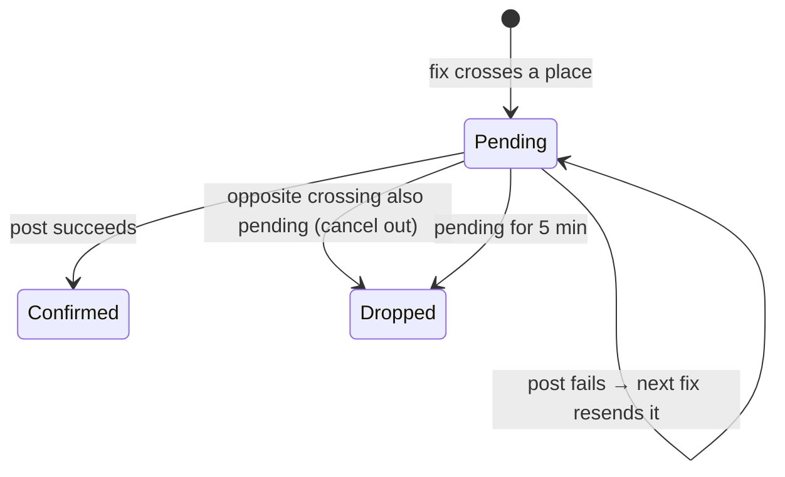

# Places

[← Architecture](../architecture.md)

A place is an area of a group (home, school…), a centre and a radius. Members are told when
someone arrives or leaves.

Places used to be called circles. The name changed everywhere: the API (`/places`, the
`place.*` frames), the server's tables (`ag_place`, `places_version`, renamed by the `places`
changeset), the app's Room table (`ag_place`, renamed by the migration to version 9) and the
notification channel. Only the encryption AADs keep `circle`, so the places already stored stay
readable ([Encryption](encryption.md)).

## Storage

Any member creates, edits and deletes places with `PUT|DELETE
/api/v1/anonymous-groups/{id}/places/{placeId}`; the app generates the id. Centre, radius and
name are three encrypted fields of fixed size ([Encryption](encryption.md)), so every place looks
the same to the server. Changes reach the group as `place.upserted` / `place.deleted`
([Real-time](realtime.md)).

A radius goes from 30 m to 5 km, a limit of the app only: the server can't read it. The editor
takes it typed, or from a logarithmic slider, so the small radii of a house or a school are as
easy to pick as the large ones, with 100 m, 250 m, 500 m and 1 km one tap away.

## Geofencing on the sender's phone

Crossings are computed by the member who crosses, never by the server (it can't read positions)
or by the receivers (they'd need our positions continuously). `GeofenceTracker`, one per group,
tracks only ourselves:

- it feeds on our own fixes and ignores inaccurate ones;
- it starts silently from the first fix; a place added, moved or resized takes the state of the
  last position the server got from us (if under 5 minutes old), so a crossing made since is
  announced but a place created around us isn't, and editing a place notifies nobody;
- its places come from Room, refreshed when a location post finds they changed, and events are
  only ever sent computed on the places the server has
  ([Sending positions](sending.md#keeping-the-places-current));
- each transition is a place event: place id + enter/exit, one AES-GCM field of 33 bytes, no
  timestamp (receivers use the server's).

## Delivery: confirmed by the server

A place event only ever comes from a position, so it travels in the same request as that position
([Sending positions](sending.md)). There is no queue: the tracker compares against the last state
**the server confirmed** (the places it knows we are in), not the last state seen.

- A failed post changes nothing, so the next position recomputes and resends the same transitions.
- An entry and an exit both unconfirmed cancel out and are never sent.
- One unconfirmed for 5 minutes is dropped: receivers use the server's time, and a late "arrived
  home" would be wrong.
- The confirmed state is only in memory: after the process restarts the tracker reseeds silently,
  and a transition pending at that moment, or made while the process was dead, isn't notified.
  Persisting it in Room is an open point ([Roadmap](../roadmap.md)).

The server checks at most 16 events per request, each at its exact size, before relaying anything,
then publishes them in order as `place.event` frames with its own timestamp. Place events are
never stored.

## Notifications

Notifications come only from live `place.event` and sharing frames, never from stored records:
by push ([Push notifications](push.md)); a server without a push relay notifies nothing.
`PlaceNotifier` shows them: one notification per member, replaced by each new event, under one
summary per group (`PlaceNotificationBook`); they expire after 1 hour. Muted places and members
are kept only in Room: a place is muted with its bell in the Places list (or all of them from
its menu), a member from their details on the map, which also silences their sharing changes.
