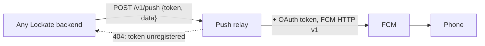

# Push relay

[← Architecture](../architecture.md)

A small service we run, once, that forwards pushes from any Lockate server to FCM with our Firebase
project's credentials. Code and API: [`push_relay/README.md`](../../push_relay/README.md).

## Why it's needed

The published app contains the configuration of one Firebase project, ours. Its FCM tokens belong
to that project, and FCM accepts sends to them only with an OAuth token of the project's service
account (the legacy server key was shut down in 2024). That key is a secret: whoever holds it can
push to every phone with the app, use up the quota or get the project suspended, and its permission
can't be limited to some tokens. So it can't be given to self-hosted servers. Matrix (Sygnal) and
Nextcloud solve the same problem the same way.

| Considered | Dropped because |
|---|---|
| An API key per backend, issued by us | Needs a sign-up and a key database, and tells us who self-hosts. |
| Giving backends our service-account key | See above. |
| A Firebase project per server, its config passed to the app at runtime | An FCM token from a secondary `FirebaseApp` isn't documented and could break with any SDK update, and every self-hoster would need Firebase. |

## Authentication: the token is the permission

The relay forwards any request carrying a token, like Sygnal. FCM tokens aren't public: only the
app and the servers the user registered with know them, and those may push anyway. A leaked token
lets someone wake that phone, not show anything (without the push key the app drops it), and the
rate limits bound the damage. No sign-up, no keys, no state.

Later, if needed: bind a token to the backends allowed to push to it (Nextcloud-style signed
requests), see [Roadmap](../roadmap.md).

## What it sees

The FCM token, the calling server's IP, when and how often it pushes, the registration id, the
payload size, and so that several registration ids go to the same phone. Not groups, members or
contents: `data` is sealed by the backend ([Push notifications](push.md)).

## API

`POST /v1/push {token, data}`: 200 sent; 400 no token or data, more than 8 entries or 3072
characters; 404 FCM says the token is unregistered; 429 over 30 a minute per token or 1200 per IP
(in memory, per instance); 502 any other FCM failure. FCM HTTP v1 with `android.priority = HIGH`.

## How it's built and run

- Quarkus compiled native, not Spring Boot: no state and almost no code, and a native binary
  starts in milliseconds, so it can scale to zero. No Firebase Admin SDK (heavy, awkward in a native
  image): the access token comes from the metadata server on Google Cloud, or from a JWT signed with
  a service-account key file (`GOOGLE_APPLICATION_CREDENTIALS`).
- Docker image `lockate-push-relay`, released with the backend under the same tag.
- Hosted on **Cloud Run** in the Firebase project: free tier, scales to zero, and it calls FCM with
  its own identity, so there is no key file to guard. The price: Google also sees which servers'
  IPs push. An EU VPS with a key file is the alternative; a domain of ours in front would make the
  move invisible to servers.
- Deployed with Terragrunt (`push_relay/terraform/`): a module creating the `push-relay` service
  account (FCM admin role only, no key), an Artifact Registry repository proxying Docker Hub and
  the public Cloud Run service (0–3 instances, 256 MiB, `RELAY_BEHIND_PROXY=true`, CPU only while
  a request is handled, so billed per request: the relay calls FCM inside the request), and
  optionally a `push-relay-dev` service account whose key a locally run relay uses; run per
  environment from `live/prod` and `live/staging` ([Environments](environments.md)).
- A self-hoster who builds the app with their own Firebase project runs their own relay and sets
  `PUSH_RELAY_URL` to it.
