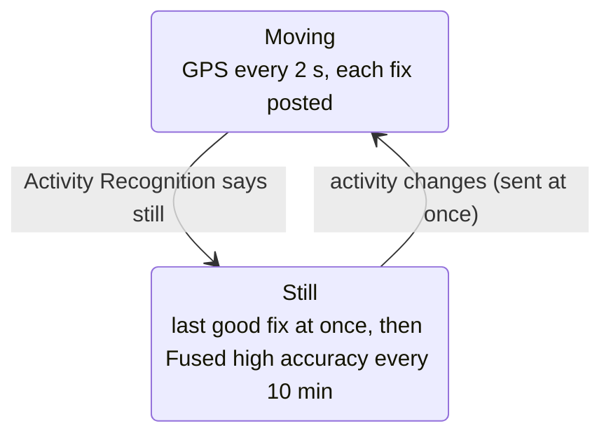
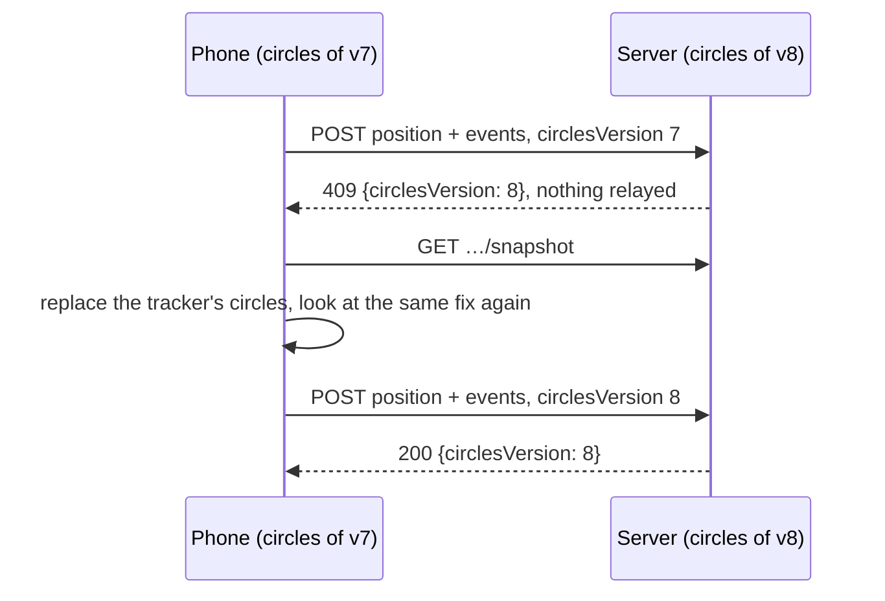

# Sending positions

[← Architecture](../architecture.md)

While a member shares with a group, the foreground service follows its position and posts it. The
service runs only while some group is shared.

## Modes



**Moving.** Each GPS fix is posted at once, at the pace of the GPS (every 2 s), with nothing
dropped: a change of activity or a circle crossing goes out with the fix that brings it. Posts go
one at a time, so they reach the server in order. OkHttp keeps the
connection open between posts (HTTP/2 over TLS when the server or its proxy offers it, HTTP/1.1
keep-alive otherwise; the reverse proxy must allow it), so a post costs about as much as a socket
frame. In a tunnel nothing is
posted, and there is no connection state to clean up.

**Still.** `PositionProvider` releases the 2 s GPS request, posts the last good fix at once, then
one on every fix of a high-accuracy Fused request every 10 minutes (`STILL_FIX_INTERVAL_MILLIS`).
Every group's send loop collects the positions, and they share that one request, which runs only
while one of them is still, so the phone gets one callback and takes one wake lock for all the
groups. `pickGoodFix` keeps an inaccurate indoor fix from replacing the last good one.

**Moving again.** The GPS comes back and the last good fix is held until an accurate one arrives
(at most 20 s), so a poor first fix can't fake a departure.

## Why the location request is the timer

A still phone must keep saying it is sharing. Timing that on the phone with a coroutine `delay`
failed: once the GPS is off nothing wakes the CPU, `delay` doesn't count the time the CPU sleeps,
and in Doze the post came minutes late, so the group saw "stopped sharing".

Fused delivers location updates in Doze to a location foreground service, so the 10-minute request
itself wakes the phone. Fused keeps the CPU on only while it calls us, so the callback takes a
10 s wake lock (`LocationService`) until the send loops pick the fix up. Each send then holds its
own wake lock until it is done (`WakeLockService`, at most 1 minute), and every post has a 15 s
timeout, set per request with Ktor's `HttpTimeout` (OkHttp's `callTimeout` would also cut the SSE
streams). The timeouts don't count the time the CPU sleeps: a post stuck on a connection that died
silently (the NAT dropped it) used to wait out OkHttp's 30 s over many 10-minute wakes, and the
group saw nothing from us for half an hour. Now it fails while the phone is awake and is sent once
more at once on a new connection (only when the network is there; the server may have got the
first one, so a circle event can reach the others twice), instead of waiting for the next fix.

An Activity Recognition transition wakes the phone the same way, and the system keeps the CPU on
only while `onReceive` runs, so `ActivityService` takes the same 10 s wake lock there. Without it
the CPU could sleep before the send loops reached their post: the switch to still, which posts the
last good fix without waiting for a new one and turns the 2 s GPS off, then waited for the next
still fix, 10 minutes later, and the switch to moving waited for any wake-up if the CPU slept
before the 2 s request was made. Neither lock is released by hand: nothing knows when every
group's send loop has taken its own, so they time out.

| Considered | Dropped because |
|---|---|
| Exact `AlarmManager` alarm every minute | Needs "Alarms & reminders", denied by default on Android 14+; an inexact alarm is only guaranteed within an hour. |
| Server pings over a socket | Keeps a socket and a foreground service for groups we don't share with (that is what FCM is for), and a location service that uses no location is a Play policy risk. |
| WorkManager | Periodic work is at least 15 min and deferred by design. |
| WebSocket while moving | Works, but needs its own liveness rules and a switch between socket and REST; REST on a reused connection costs about the same and leaves one way to send. |

**Why 10 minutes.** It halves the GPS wake-ups and requests of a 5-minute interval, the main cost
while still. The price: a still position up to 10 min old, and when Activity Recognition misses a
movement (a train, a smooth car), positions and circle events up to 10 min late; once it sees the
movement the GPS runs every 2 s again. It is one constant. The map colours are built around it
([Sharing](sharing.md)).

## The endpoint

`POST /api/v1/anonymous-groups/{id}/locations` (`AGMemberMessageService`):

```json
{ "encryptedCoordinates": {…}, "encryptedActivity": {…},
  "circleEvents": [{ "cipherText": "…", "iv": "…" }], "circlesVersion": 7 }
```

- Everything is checked before anything is relayed: at most 16 circle events, every field at its
  exact size ([Encryption](encryption.md)). A bad request is a 400 and relays nothing.
- Circle events computed on circles the server no longer has are refused: with events, a
  `circlesVersion` other than the group's (or none) is a **409 `{circlesVersion}`** that relays
  nothing ([below](#keeping-the-circles-current)).
- Then the position is relayed to the group's SSE streams, kept as the member's last position
  (saved every 2 min, [Retention](groups-and-auth.md#retention)), refreshes the sharing timer ([Sharing](sharing.md)),
  and each circle event is published in order ([Circles](circles.md)).
- The answer is `{circlesVersion}`, the version of the group's circles.
- At most 120 posts per member per minute (`rate:location:{memberId}`), 429 above. The app sends
  at most 30, so only a broken or malicious client hits it.
- A failed post is dropped; the next fix replaces it (its circle events are recomputed). One that
  failed while offline is posted again as soon as the network returns (`postEach`), unless a newer
  fix comes first: while still the next fix is 10 minutes away. With the network there (the server
  is down) nothing is resent, so there is no burst, and the next fix retries.

`POST /api/v1/anonymous-groups/{id}/members/pause` is sent when sharing stops (best effort, 10 s
timeout): the others are told at once instead of when the timer expires.

## On the phone

`AnonymousGroupService` owns the networking. The foreground service (`AndroidSendLocationService`)
calls `holdAllSharing`, which runs `holdSharing` for each group we share with (member, group still
there, sharing on) and follows the groups that start or stop being shared. `holdSharing` follows our
location through `PositionProvider`, runs the group's `GeofenceTracker` and posts each position with
its circle events, one post at a time, then posts `members/pause` when it stops. A post answered 401
or 404 marks the group removed or deleted, which stops its sharing.

The service stops itself when no group is shared. It is started at app launch, when the app sees a
group start being shared (created, joined, sharing turned on), and on boot; with nothing to share it
stops at once. Nothing else needs it: notifications come by push
([Push notifications](push.md)), and the stream of the group on screen is held by the screen.

Its notification says only "Sharing your location", or "Location is off" while the location is
disabled or unavailable, since sharing can't work then and only the user can fix it. It doesn't
say whether the posts get through: one fails for a moment in a tunnel or on a network change, and the
map shows a banner for the server of the group on screen when it can't reach it.

## Keeping the circles current

The tracker needs the group's circles, and with no stream open the phone isn't told when someone
creates, moves or deletes one. The group has a version of its circles, a counter
(`anonymous_group.circles_version`) bumped in the same transaction as every circle change, and
every location post is a conditional request on it, like an HTTP `If-Match`:



- **Events on other circles are refused.** The post says on which version its events were
  computed; with events, any other version (or none) is a 409 carrying the current one, and nothing
  is relayed. The phone fetches the snapshot, replaces the tracker's circles and computes the events
  of the same fix again, then posts again. So no event goes out about a deleted circle (which would
  make every receiver fetch the snapshot for nothing) or about a circle that moved.
- **A post without events is accepted on any version**, and its answer carries the current one.
  When it differs, the phone fetches the snapshot, replaces the circles and looks at the same fix
  again; if that gives events (a new circle it just crossed), it posts again with them.
- **A changed circle takes the state of the last position the server got from us.**
  `GeofenceTracker` seeds a new, moved or resized circle from the position of the last post that
  went through (if under 5 minutes old, the same limit as pending events; else from where we are),
  and the same fix is looked at again: a crossing made since that post is announced, also one made
  while the posts were failing, while a circle created around a still phone isn't. The circles are
  replaced before the post that brought the new version is confirmed, so that post's position isn't
  taken as the base.
- `holdSharing` keeps the version in memory, starting from none, so the first post of a sharing
  session always fetches the circles once. A failed fetch keeps the old version and the next post
  tries again; if the circles keep changing it gives up until the next position (`MAX_CIRCLE_REFRESHES`).

Why a conditional post rather than posting the position first and the events after fetching the
circles: it computes the same and in the usual case sends one request instead of two for each
crossing, and the position and its events stay one request, so they arrive together or not at all.

It costs one indexed read per post on the server, one fetch per change (or per sharing start) on the
phone, and rides on posts the phone sends anyway: a moving phone learns of a change within seconds, a
still one within 10 minutes. Pushing circle changes instead would add a push per change for every
member and still leave the tracker stale whenever one is lost.

The version is a monotonic `BIGINT` that never resets while the group exists; the phone only
compares it for equality, so its size doesn't matter (at 1000 changes a second it would take
hundreds of millions of years to overflow, and over 200,000 to leave a JavaScript number's exact
range).

What emulators can't show: Activity Recognition never reports there, and the emulator CPU doesn't
sleep, so still mode and the original Doze bug need a real phone.
