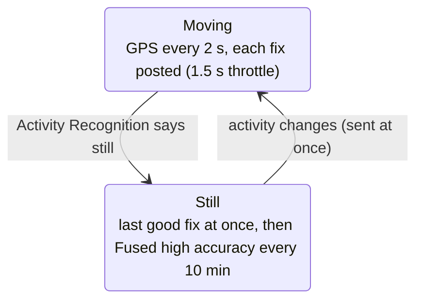

# Sending positions

[← Architecture](../architecture.md)

While a member shares with a group, the foreground service follows its position and posts it.

## Modes



**Moving.** Each GPS fix is posted at once (at most one every 1.5 s; skipped while circle events
wait for a post). Posts go one at a time, so they reach the server in order. OkHttp keeps the
connection open between posts (HTTP/2 over TLS when the server or its proxy offers it, HTTP/1.1
keep-alive otherwise; the reverse proxy must allow it), so a post costs about as much as a socket
frame. In a tunnel nothing is
posted, and there is no connection state to clean up.

**Still.** `PositionProvider` releases the 2 s GPS request, posts the last good fix at once, then
one on every fix of a high-accuracy Fused request every 10 minutes (`STILL_FIX_INTERVAL_MILLIS`).
`pickGoodFix` keeps an inaccurate indoor fix from replacing the last good one.

**Moving again.** The GPS comes back and the last good fix is held until an accurate one arrives
(at most 20 s), so a poor first fix can't fake a departure.

## Why the location request is the timer

A still phone must keep saying it is sharing. Timing that on the phone with a coroutine `delay`
failed: once the GPS is off nothing wakes the CPU, `delay` doesn't count the time the CPU sleeps,
and in Doze the post came minutes late, so the group saw "stopped sharing".

Fused delivers location updates in Doze to a location foreground service, so the 10-minute request
itself wakes the phone. The callback takes a 10 s wake lock (`LocationService`) so the post goes
out before the CPU sleeps again.

| Considered | Dropped because |
|---|---|
| Exact `AlarmManager` alarm every minute | Needs "Alarms & reminders", denied by default on Android 14+; an inexact alarm is only guaranteed within an hour. |
| Server pings over a socket | Keeps a socket and a foreground service for groups we don't share with (that is what FCM is for), and a location service that uses no location is a Play policy risk. |
| WorkManager | Periodic work is at least 15 min and deferred by design. |
| WebSocket while moving | Works, but needs its own liveness rules and a switch between socket and REST; REST on a reused connection costs about the same and leaves one way to send. |

**Why 10 minutes.** It halves the GPS wake-ups and requests of a 5-minute interval, the main cost
while still. The price: a still position up to 10 min old, and when Activity Recognition misses a
movement (a train, a smooth car), positions and circle events up to 10 min late; once it sees the
movement the GPS runs every 2 s again. It is one constant. The map colours are built around it
([Sharing](sharing.md)).

## The endpoint

`POST /api/v1/anonymous-groups/{id}/locations` (`AGMemberMessageService`):

```json
{ "encryptedCoordinates": {…}, "encryptedActivity": {…}, "circleEvents": [{ "cipherText": "…", "iv": "…" }] }
```

- Everything is checked before anything is relayed: at most 16 circle events, every field at its
  exact size ([Encryption](encryption.md)). A bad request is a 400 and relays nothing.
- Then the position is relayed to the group's SSE streams, maybe saved (at most every 2 min,
  [Retention](groups-and-auth.md#retention)), refreshes the sharing timer ([Sharing](sharing.md)),
  and each circle event is published in order ([Circles](circles.md)).
- At most 120 posts per member per minute (`rate:location:{memberId}`), 429 above. The app sends
  at most 40, so only a broken or malicious client hits it.
- A failed post is dropped; the next fix replaces it (its circle events are recomputed).

`POST /api/v1/anonymous-groups/{id}/members/pause` is sent when sharing stops (best effort, 10 s
timeout): the others are told at once instead of when the timer expires.

## On the phone

`AnonymousGroupService` owns the networking. `holdChannel` keeps a group's channel open while
someone needs it (the foreground service for every group, the open map); while the group has a
send lease the channel follows our location through `PositionProvider`, runs the group's
`GeofenceTracker` and posts each position with its circle events, one post at a time, then posts
`members/pause` when the lease ends. The foreground service restarts on boot; today it runs for
every group we are in, since it also holds the group sockets, and after the switch-over it will run
only while a group is shared ([Roadmap](../roadmap.md)).

What emulators can't show: Activity Recognition never reports there, and the emulator CPU doesn't
sleep, so still mode and the original Doze bug need a real phone.
